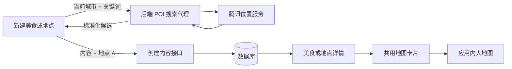

# Crush Date 腾讯地图接入预开发说明

> 更新日期：2026-08-17  
> 适用范围：Crush Date 前端（Vue 3 + TypeScript + uni-app）和现有后端 POI 接口

## 1. 当前结论

地图功能可在现有架构内实现，不需要拆分 H5 和微信小程序两套业务页面。当前第一阶段范围已经收敛为：

1. 新建美食或想去地点时，可选搜索并绑定一个腾讯 POI（地点 A）。
2. 后端保存 POI 标准名称、地址、GCJ-02 经纬度、行政区划和腾讯 POI ID。
3. 美食与地点详情在存在 `location` 时展示地址和地图预览。
4. 点击预览进入应用内地图页，以地点 A 为中心拖动、缩放并查看周边底图。

本阶段不读取用户当前位置，不打开系统地图，也不实现地点 B、距离或路线规划。

## 2. 本阶段已确定的产品形态

### 2.1 新建时选填地点

- 在美食分类或地点分类下方、“想说的话”上方放置“添加地点（选填）”。
- 默认折叠，不绑定地点也能按原流程创建。
- 首次展开时，内容名称不少于 2 个字符则作为可编辑搜索词。
- 搜索使用应用左上角当前城市，不申请设备定位权限。
- 输入 trim 后为 2～50 个字符，使用约 400ms 防抖。
- 候选展示腾讯标准名称、区县和地址。
- 用户必须主动选择候选，不自动使用第一项。
- 选中后可以更换或清除，内容名称不会被 POI 名称覆盖。
- 搜索失败可重试或跳过地点，不能阻断原有创建能力。

### 2.2 详情地图

- 后端返回 `location: null` 时不展示空地图，兼容旧数据。
- 存在位置时展示 POI 标准名称、地址、地图和单个 marker。
- 地图卡片位于评论下方、状态区域上方。
- 点击卡片或“查看地图”进入应用内地图页。
- 地图页通过 `kind + id` 重新请求详情，不依赖上一页内存。
- 大地图仅展示地点 A，允许拖动、缩放和浏览腾讯底图周边。

## 3. 当前接口约定

### 3.1 POI 搜索

```http
GET /api/crush-date/map/poi-suggestions?cityCode=beijing&keyword=海底捞
```

前端只向 Crush Date 后端发送城市与关键词。腾讯 WebService Key、IP 白名单、缓存、限流和上游异常转换由后端负责，Secret Key 不进入 H5 或小程序包。

标准化候选：

```ts
interface PoiSuggestion {
  provider: 'tencent'
  poiId: string
  title: string
  address: string
  latitude: number
  longitude: number
  adcode: string
  city: string
  district: string
}
```

前端分别处理：

- `400`：参数或关键词不符合要求。
- `429`：搜索频率受限。
- `502/503/504`：腾讯服务或上游暂时不可用。
- 空列表：没有匹配结果。
- 请求失败：网络连接异常。

### 3.2 创建内容

创建仍使用 `POST /api/crush-date/content-items` 和 `multipart/form-data`。选中地点后追加以下七个字段；未选择时七个字段全部省略：

| 字段           | 来源                 |
| -------------- | -------------------- |
| `poiProvider`  | `location.provider`  |
| `poiId`        | `location.poiId`     |
| `poiTitle`     | `location.title`     |
| `poiAddress`   | `location.address`   |
| `poiLatitude`  | `location.latitude`  |
| `poiLongitude` | `location.longitude` |
| `poiAdcode`    | `location.adcode`    |

地点字段必须作为完整集合提交，不发送半套位置或城市中心伪坐标。

### 3.3 详情响应

```ts
interface ContentLocation {
  provider: 'tencent'
  poiId: string
  title: string
  address: string
  latitude: number
  longitude: number
  adcode: string
}

interface ContentItemResponse {
  // 原有字段保持不变
  location: ContentLocation | null
}
```

## 4. 跨端地图方案



- 微信小程序使用 uni-app 原生 `<map>`，坐标为腾讯体系使用的 GCJ-02。
- H5 使用腾讯 JavaScript API GL，Key 通过 `VITE_TENCENT_MAP_KEY` 注入。
- `.env.example` 只保留占位符，真实 Key 放在 Git 已忽略的环境文件中。
- H5 Key 需要在腾讯位置服务控制台配置域名白名单。
- Key 缺失或脚本加载失败时保留名称、地址和明确错误，不影响详情其他操作。
- 当前不增加定位权限，也不调用 `uni.getLocation` 或 `uni.openLocation`。

## 5. 后续阶段

以下功能明确不在当前交付范围内：

### 阶段二：地点 B 与距离

- 在地点 A 的地图页搜索并选择地点 B。
- 同时显示 A/B 两个 marker，并调整视野包含两点。
- 展示直线距离，或由后端距离矩阵代理返回实际道路距离。
- 地点 B 只用于本次比较，不修改内容已绑定的地点 A。

### 阶段三：路线规划

- 步行、驾车和骑行路线摘要。
- 公交、地铁换乘方案与预计耗时。
- 公交地铁规划可使用腾讯 `/ws/direction/v1/transit`，但必须由后端提供安全代理接口。

开发上述阶段前，后端至少需要补充地点 B 搜索上下文、距离矩阵或路线代理、缓存、限流、超时与统一错误码。前端不应直接持有 WebService Secret Key。

## 6. 验收要点

- 北京、天津、哈尔滨分别使用当前应用城市搜索 POI。
- 少于 2 个字符不请求；快速改词时旧响应不能覆盖新结果。
- 新建美食和地点均可选择、更换、清除或跳过地点。
- 有地点时七个 multipart 字段完整提交，无地点时全部省略。
- 详情刷新后可独立取得 `location`，旧记录保持原样。
- H5 和微信小程序均能显示单个 marker，并进入应用内大地图。
- 404、地图 Key 缺失、地图脚本加载失败和无效坐标均有可理解的降级提示。

## 7. 配置与安全边界

- 后端腾讯 WebService Key：只存在于服务端环境，不写入本文档或前端仓库。
- H5 JavaScript API Key：写入未提交的 `.env.development`、`.env.production` 或部署平台环境变量，并限制允许域名。
- 小程序 AppID、腾讯 Key、账号、Token 和真实密钥均不得提交到 Git。
- 微信真机访问后端时不能使用电脑的 `localhost`，仍需配置手机可访问的 HTTPS 地址。
